# gogoga-words

把一个主题拆开，用图讲清楚，用英语说出来。

给出一个主题和孩子的英语水平，就能做出导图、图文词卡、亲子讲读页和可打印的英语活动。

A collection of [Agent Skills](https://agentskills.io/specification) for illustrated English learning materials for children.

| 想让孩子练什么 | 选哪个技能 |
| --- | --- |
| 看懂一个事物的部位、特征和变化 | [主题思维导图](#主题思维导图) |
| 看图认一组词，比如水果、衣服或动物 | [基础词汇图文卡](#基础词汇图文卡) |
| 和大人一起看图问答，或指着场景跟读 | [亲子讲读页](#亲子讲读页) |
| 自己看图复述，或动手剪贴配对 | [打印互动练习](#打印互动练习) |
| 听到英文词，在棋盘上找到对应图片 | [图词宾果](#图词宾果) |
| 扮演顾客和店员，用英语完成购物任务 | [情景任务包](#情景任务包) |
| 把四张图排好，按顺序讲一个故事 | [四格故事与复述](#四格故事与复述) |
| 把字母音连起来读，再读一本短元音小书 | [短元音拼读小书](#短元音拼读小书) |

[切换脑图风格](#切换脑图风格) · [给脑图加学习标注](#给脑图加学习标注) · [切换词卡风格](#切换词卡风格)

## 安装

在目标项目的根目录运行，按提示选择 Codex、Claude Code、Cursor 或其他客户端。需要 Node.js 22.20 或更新版本。 [Skills CLI 安装说明](https://github.com/vercel-labs/skills/blob/main/docs/commands.md#skills-add)

```sh
npx skills add JackWeiGogoga/gogoga-words --skill gogoga-words-mindmap
```

把 `--skill` 后的名字换成下方章节里的技能名，或省略它并在安装时选择。用 `--agent claude-code` 可以指定客户端，`-g` 可以安装到用户目录以供多个项目使用。如果已有本地源码，把命令里的仓库名换成本地目录路径即可。

也可以把 [skills](skills/) 下所需技能的完整文件夹复制到客户端的技能目录。 [各客户端的技能目录](https://github.com/vercel-labs/skills/blob/main/docs/agents.md)

安装后，把下面的示例指令发给 agent，按需换成自己的主题和孩子的英语水平。在 Codex 中也可以用 `$gogoga-words-mindmap` 这类写法点名调用。可以提供透明插画，或让支持生图的 agent 绘制。点击任意示例图可查看原图。

## 主题思维导图

技能名：[gogoga-words-mindmap](skills/gogoga-words-mindmap)

围绕一个事物展开，把能指认的部位、能比较的特征和能按顺序讲的过程画在同一张图上。科普主题可以用切面看内部、侧视图学部件、连续图讲步骤。

### 切换脑图风格

在对话里告诉 agent 你要的画法。下面的指令可以直接使用。

```text
用 gogoga-words-mindmap 做一张平涂卡通风格的推土机英语导图。
用侧视图标出铲刀和履带，再用四张小图讲推土过程。
```

| 彩铅水彩 `watercolor`（默认） | 平涂卡通 `flat` | 科普线描 `diagram` |
| :---: | :---: | :---: |
| <a href="examples/bulldozer/bulldozer.png"></a> | <a href="examples/bulldozer/bulldozer-flat.png">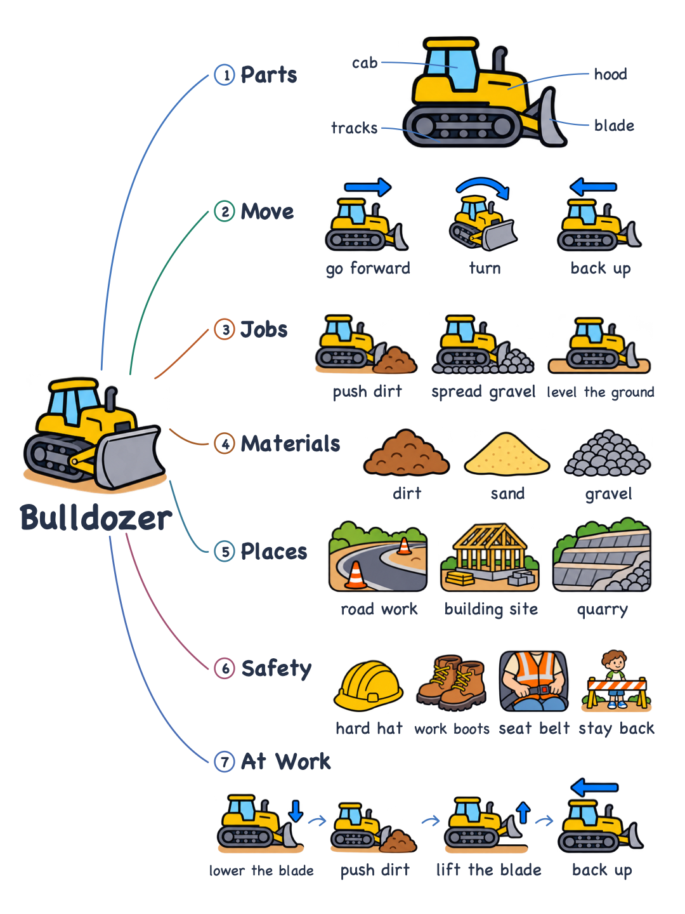</a> | <a href="examples/bulldozer/bulldozer-diagram.png">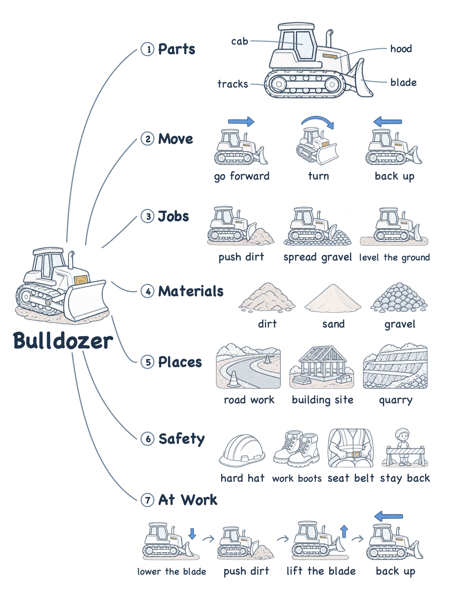</a> |

从仓库根目录运行下面的命令。将 `flat` 换成 `watercolor` 或 `diagram`，即可用同一份推土机清单切换画风。

```sh
uv run --script skills/gogoga-words-mindmap/scripts/render.py \
  examples/bulldozer/bulldozer.json bulldozer.svg --style flat
```

做新主题时，可让 agent 按指定画法生成插画，也可直接提供素材。手写清单时，在 `style` 里选页面风格，在 `assets` 里填对应插画。同一份清单需要切换多套插画时，用 `style_assets` 为各风格指定素材。参见[清单格式](skills/gogoga-words-mindmap/references/design.md#排版输入)。

其他示例见[梨的水彩导图](examples/pear/pear.png)和[梨的清单](examples/pear/pear.json)。

### 给脑图加学习标注

脑图默认只显示英文。中文释义、中文分支标题、IPA 音标和页底问答可以分别打开，并与三种画风任意组合。

```text
用 gogoga-words-mindmap 做一张平涂卡通推土机导图。
给词和分支配简短中文，只给主题词和部件词标英式音标，页底加一组看图问答。
```

<a href="examples/bulldozer/bulldozer-study.png">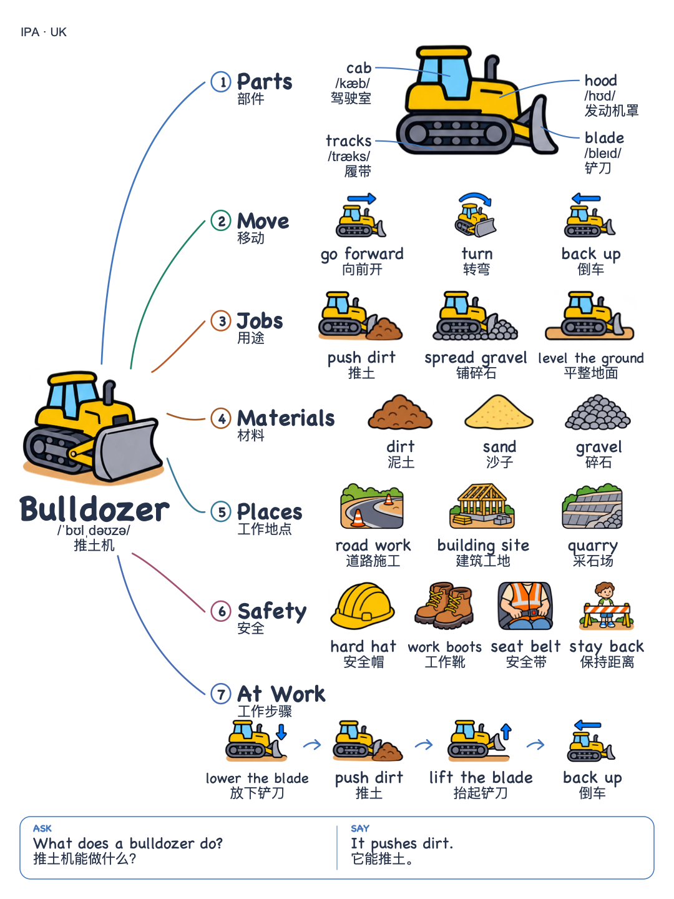</a>

用同一份推土机清单生成上面的学习版。

```sh
uv run --script skills/gogoga-words-mindmap/scripts/render.py \
  examples/bulldozer/bulldozer.json bulldozer-study.svg \
  --style flat --zh --zh-headings --ipa key --accent uk --qa
```

按需保留 `--zh`（中文释义）、`--zh-headings`（中文分支标题）、`--ipa key`（重点词音标）和 `--qa`（页底问答）。`--ipa all` 会显示清单中有对应读音的词。用 `--accent us` 切换美式读音。也可以用清单里的 `display` 保存常用组合。参见[学习标注字段](skills/gogoga-words-mindmap/references/design.md#学习标注与开口提示)。

## 基础词汇图文卡

技能名：[gogoga-words-cards](skills/gogoga-words-cards)

把同一类词排成网格，每格放一幅图、一个英文词、音标和中文释义。**彩铅水彩**适合水果等自然主题，**平涂卡通**用大色块和清楚的轮廓区分车辆、衣服等物品。也可以提供自己的照片制作**实拍词卡**，用来认实物或练日常动作。

| 水果 · 彩铅水彩 | 交通工具 · 平涂卡通 |
| :---: | :---: |
| <a href="examples/fruit/fruit.png"></a> | <a href="examples/vehicles/vehicles.png">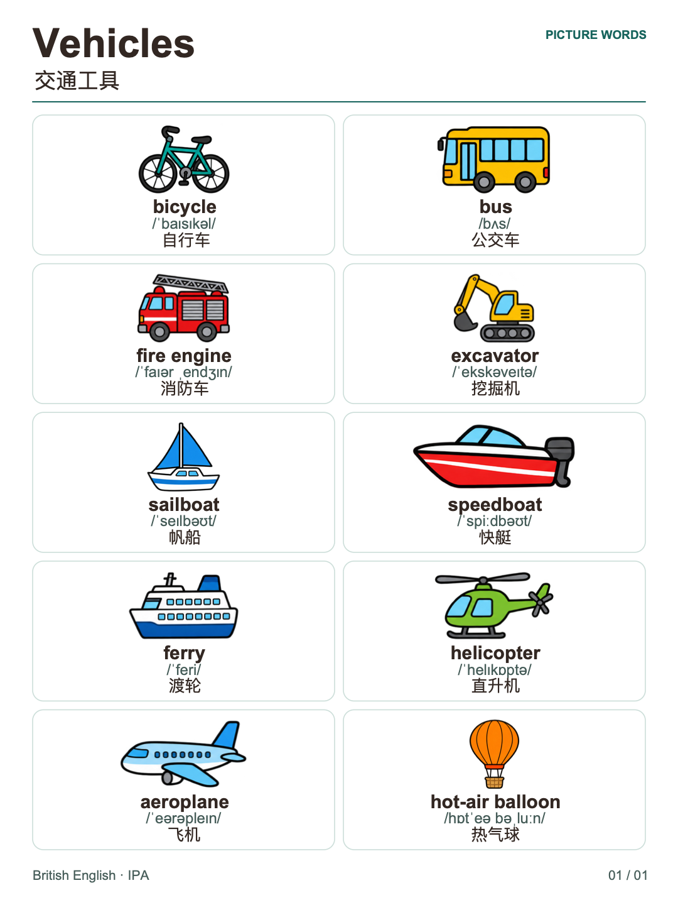</a> |

### 切换词卡风格

```text
用 gogoga-words-cards 做一张交通工具词卡。选 10 种车辆、船和飞机，排成 2 列 5 行。
用平涂卡通画清楚轮廓，每格配英文、英式音标和中文。
```

命令行用 `--style watercolor`、`--style flat` 或 `--style photo` 选择配色，也可以在清单里设置 `style`。换画法时，在清单里指定对应的插画。实拍词卡使用你提供的照片。参见[词卡清单格式](skills/gogoga-words-cards/references/manifest.md#选画法与准备素材)。

示例清单见[水果图文卡](examples/fruit/fruit.json)和[交通工具词卡](examples/vehicles/vehicles.json)。

## 亲子讲读页

技能名：[gogoga-words-read-along](skills/gogoga-words-read-along)

**看图问答**为每组图配一个问题和示范回答。**连续领读**把同组词串成一小段英文。**绘本式场景**用一幅完整插画串起单词和句子，让孩子按编号在图上找，再跟读。三种都配中文。

| 梨篇 · 看图问答 | 梨篇 · 连续领读 | 农场 · 绘本式场景 |
| :---: | :---: | :---: |
| <a href="examples/pear/pear-qa.png"></a> | <a href="examples/pear/pear-read.png"></a> | <a href="examples/farm/farm.png">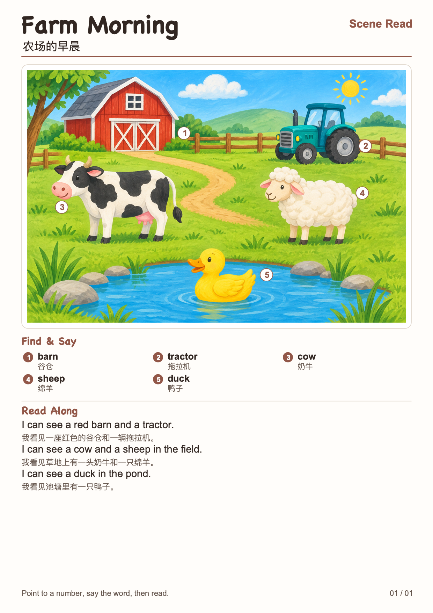</a> |

**用法示例**

```text
用 gogoga-words-read-along 做一页农场绘本式场景。
在同一张图上标出谷仓、拖拉机、奶牛、绵羊和鸭子，用“I can see…”写三句双语领读。
```

示例清单见[梨篇讲读](examples/pear/lesson.json)和[农场场景](examples/farm/scene.json)。

## 打印互动练习

技能名：[gogoga-words-practice](skills/gogoga-words-practice)

把学过的插画变成 A4 练习。**无字复述**保留分组图片、组号和空线。**贴纸页**给每张图加虚线裁切框。**剪贴配对**额外生成一张带类别标题的底板，孩子可以把图卡剪下来贴到对应的空格。练习可以用彩色图，也可以用黑白线稿涂色。

| 梨篇 · 无字复述 | 梨篇 · 剪贴排序 |
| :---: | :---: |
| <a href="examples/pear/pear-blank.png"></a> | <a href="examples/pear/pear-stickers.png"></a> |

| 交通工具 · 分类底板 | 交通工具 · 彩色剪贴 | 交通工具 · 黑白线稿 |
| :---: | :---: | :---: |
| <a href="examples/vehicles/match-01.png">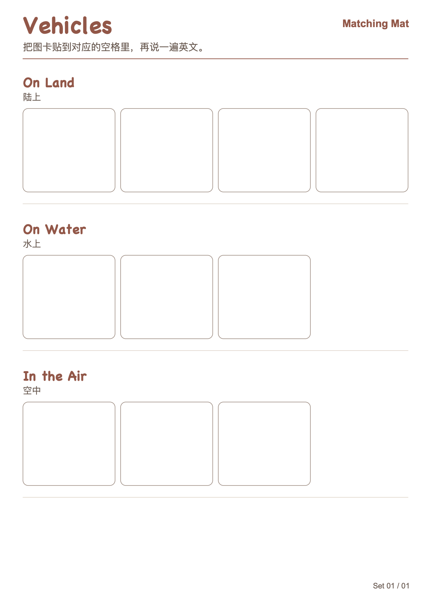</a> | <a href="examples/vehicles/match-02.png">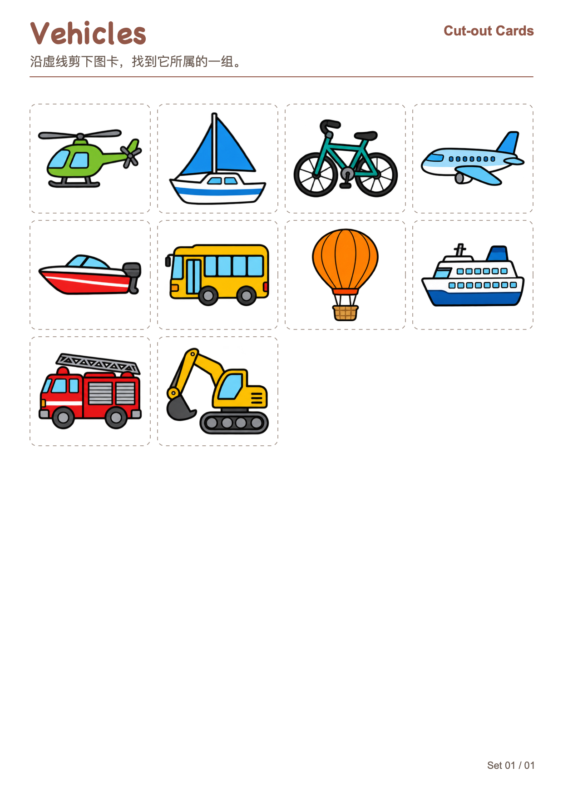</a> | <a href="examples/vehicles/match-ink-02.png">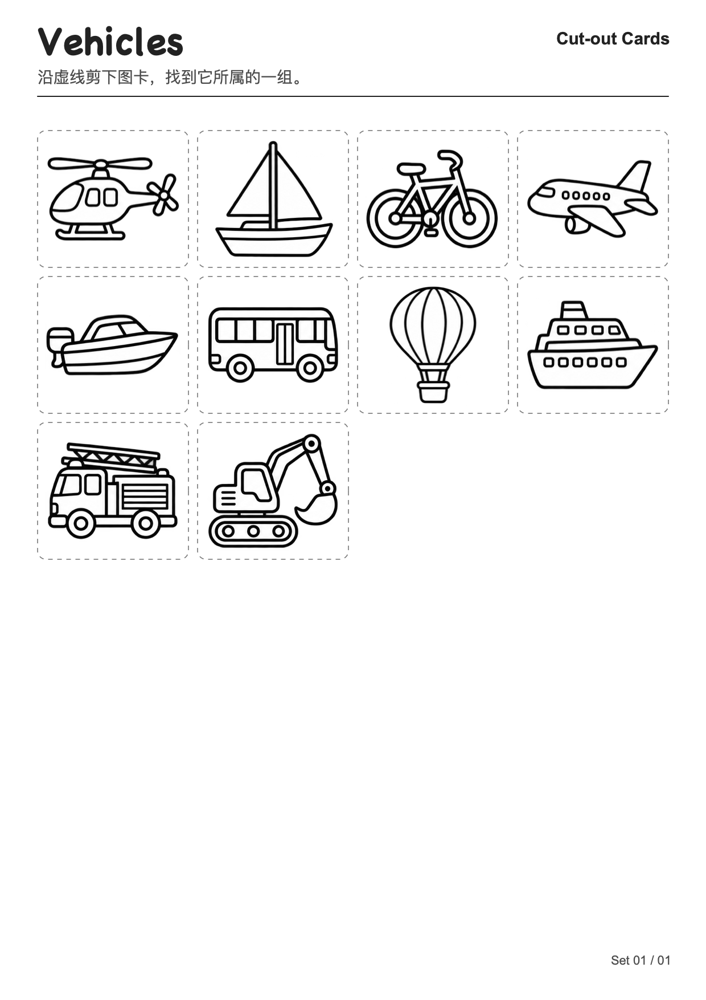</a> |

**用法示例**

```text
用 gogoga-words-practice 复用交通工具插画，做一套陆上、水上、空中的剪贴配对。
输出底板和打散顺序的图卡，再做一版可以涂色的黑白线稿。
```

练习示例见[梨篇清单](examples/pear/lesson.json)和[交通工具配对清单](examples/vehicles/practice.json)。交通工具配对复用了词卡的素材，可选彩色图或线稿。

## 图词宾果

技能名：[gogoga-words-games](skills/gogoga-words-games)

把同一组词做成多张不同的看图棋盘和带英文的叫词卡。家长或老师只念英文，孩子找图、盖住格子，连满一排就喊 Bingo。可以直接复用词卡清单。

| 交通工具 · 玩家棋盘 | 交通工具 · 叫词卡 |
| :---: | :---: |
| <a href="examples/vehicles/bingo-01.png">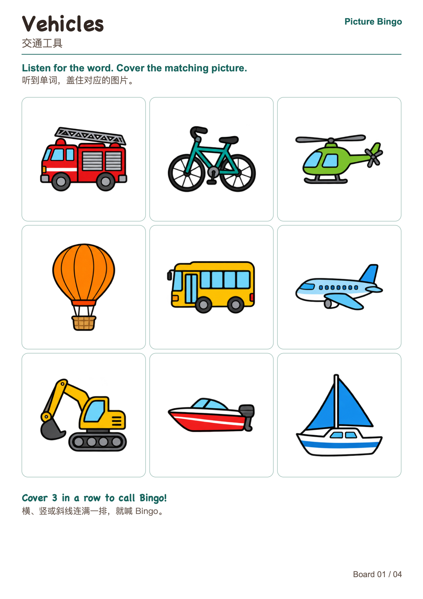</a> | <a href="examples/vehicles/bingo-05.png">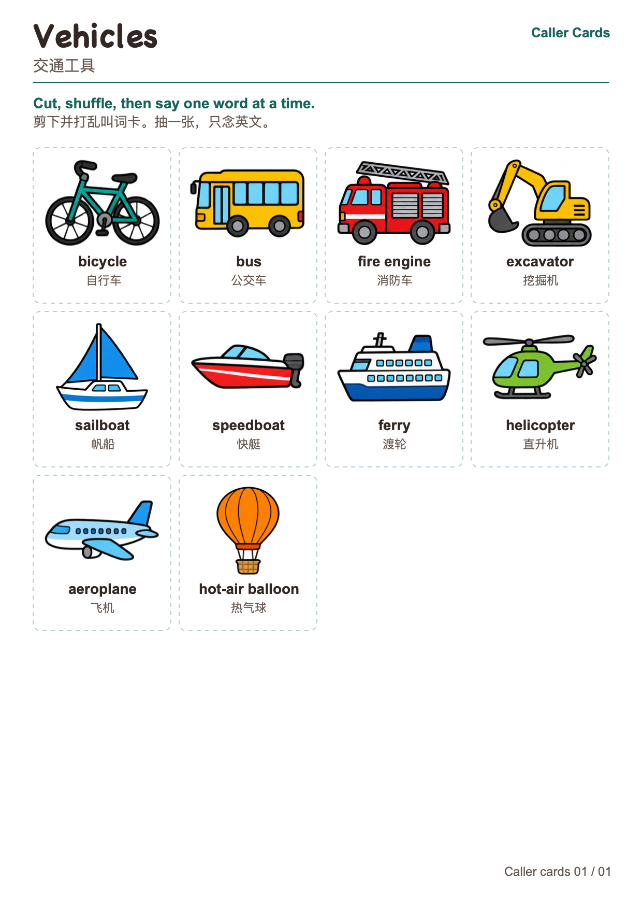</a> |

```text
用 gogoga-words-games 复用交通工具词卡，做四张 3×3 的看图宾果棋盘和一页叫词卡。
棋盘里只放图片，叫词卡上放英文和中文。
```

示例复用[交通工具词卡清单](examples/vehicles/vehicles.json)。另见[棋盘 2](examples/vehicles/bingo-02.png)、[棋盘 3](examples/vehicles/bingo-03.png)和[棋盘 4](examples/vehicles/bingo-04.png)。

## 情景任务包

技能名：[gogoga-words-roleplay](skills/gogoga-words-roleplay)

围绕一个任务安排对话。顾客拿带预算和数量的清单，店员拿库存和双语提示，双方看图询价、点单和结账。渲染时会检查预算与库存能否满足清单。

| 水果店 · 图文价目表 | 水果店 · 双语角色卡 | 水果店 · 购物任务单 |
| :---: | :---: | :---: |
| <a href="examples/fruit/fruit-shop-01.png">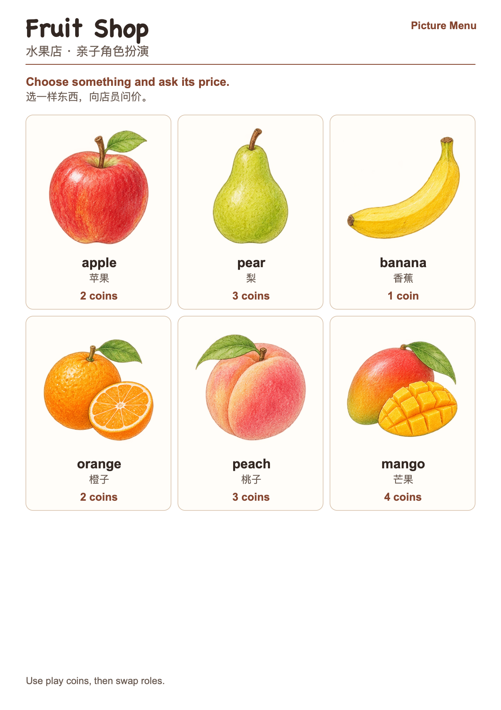</a> | <a href="examples/fruit/fruit-shop-02.png">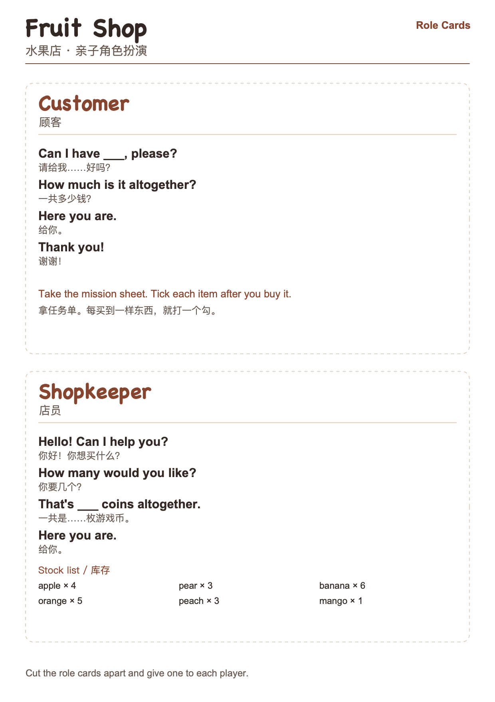</a> | <a href="examples/fruit/fruit-shop-03.png">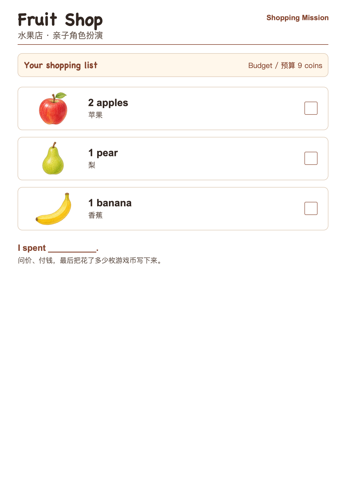</a> |

```text
用 gogoga-words-roleplay 做一个水果店任务。孩子拿 9 枚游戏币买 2 个苹果、1 个梨和 1 根香蕉。
做一页图文价目表、顾客和店员双语角色卡，以及一张购物任务单。
```

示例见[水果店清单](examples/fruit/fruit-shop.json)，插画复用水果词卡。

## 四格故事与复述

技能名：[gogoga-words-story](skills/gogoga-words-story)

用同一个角色和四个能从画面看懂的动作讲一件小事。孩子先看双语故事，再把打乱的无字图卡排回去。家长可以用提问和 `First`、`Next`、`Then`、`Finally` 帮孩子把四步讲完整。

| 滚走的苹果 · 双语故事 | 滚走的苹果 · 无字排序卡 | 滚走的苹果 · 家长复述提示 |
| :---: | :---: | :---: |
| <a href="examples/runaway-apple/story-01.png">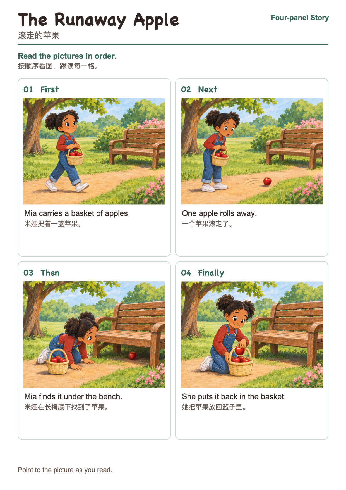</a> | <a href="examples/runaway-apple/story-02.png">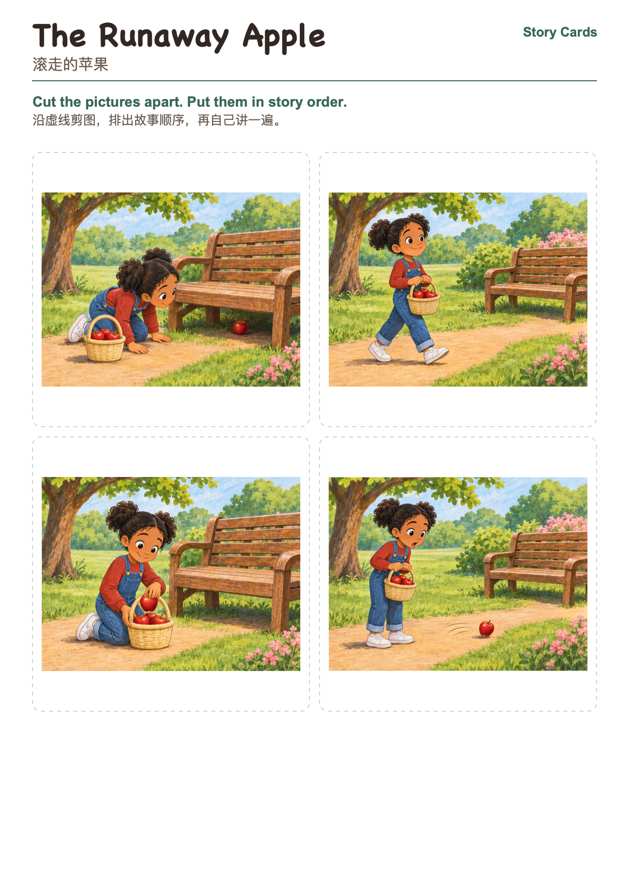</a> | <a href="examples/runaway-apple/story-03.png">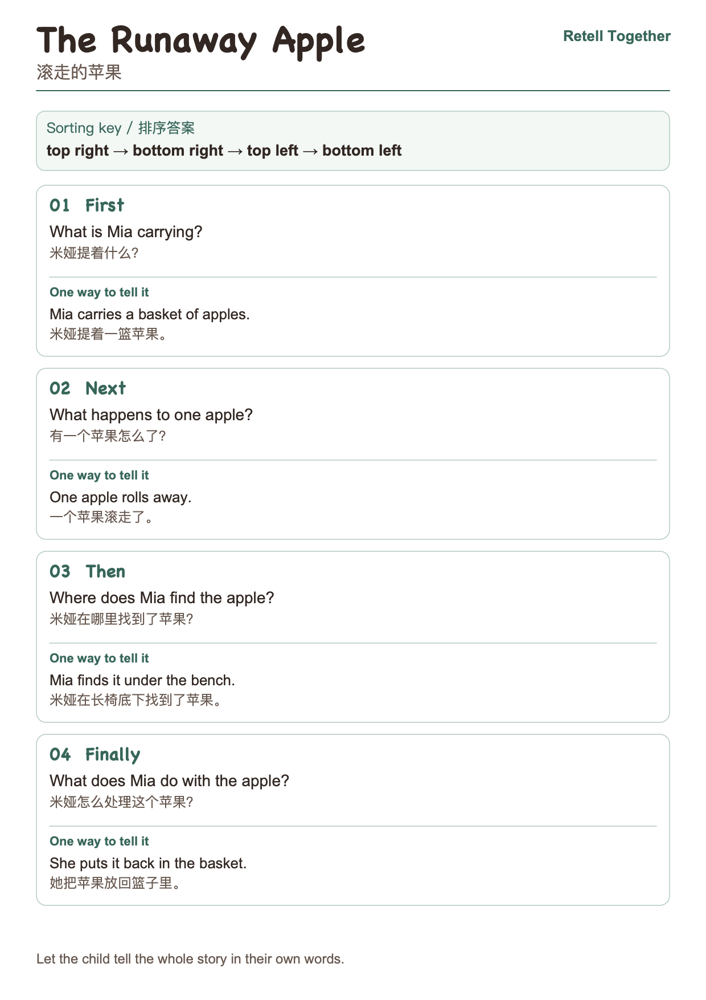</a> |

```text
用 gogoga-words-story 做四格故事《滚走的苹果》。让孩子看出苹果从篮子里滚走，最后被米娅捡回来。
每格一句简单英文和中文。另做打乱的无字图卡、排序答案和家长提问。
```

示例见[四格故事清单](examples/runaway-apple/story.json)。

## 短元音拼读小书

技能名：[gogoga-words-phonics](skills/gogoga-words-phonics)

选一个短元音，用图和字母格练习把三个音连起来读。再用这些词写一本八页小书。渲染时逐词检查，只允许所选短元音和已学字母组成的词表词，以及明确列出的辅助词。

| 短元音 a · 拼读卡 | Cat and Rat · 横向折页 |
| :---: | :---: |
| <a href="examples/short-a/short-a-01.png">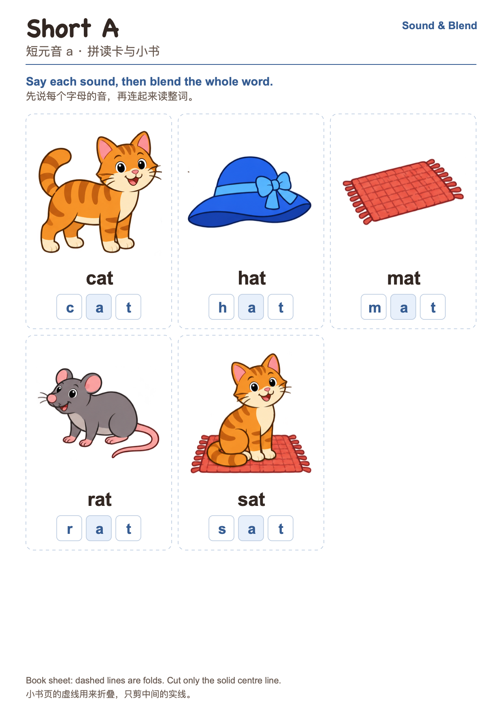</a> | <a href="examples/short-a/short-a-02.png">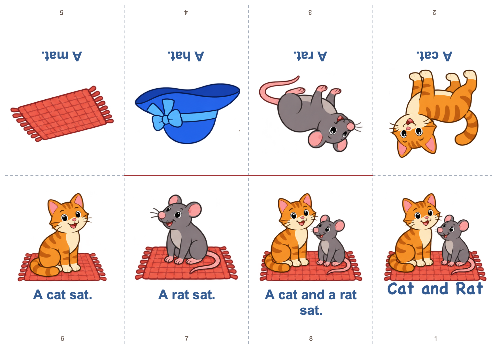</a> |

```text
用 gogoga-words-phonics 做短元音 a 的拼读卡和八页小书。孩子已学 a、c、h、m、r、s、t。
用 cat、hat、mat、rat、sat 练习合音。小书可以用 a 和 and 作辅助词。
```

示例见[短元音 a 清单](examples/short-a/phonics.json)。小书用一张 A4 横向单面打印，按[折页说明](skills/gogoga-words-phonics/references/manifest.md#折成八页小书)剪折。

## 复现示例

用 [uv](https://docs.astral.sh/uv/) 从仓库根目录渲染。首次运行会准备 Python 和 Pillow，之后可用缓存离线渲染。生成的 SVG 内嵌插画，文字可编辑。以下命令使用 macOS 自带的 `sips` 导出 PNG。只需 SVG 时，省略 `--png` 及其输出路径即可。

<details>
<summary>展开渲染命令</summary>

```sh
mkdir -p out
uv run --script skills/gogoga-words-mindmap/scripts/render.py \
  examples/pear/pear.json out/pear.svg --png out/pear.png
uv run --script skills/gogoga-words-mindmap/scripts/render.py \
  examples/bulldozer/bulldozer.json out/bulldozer.svg --png out/bulldozer.png
uv run --script skills/gogoga-words-mindmap/scripts/render.py \
  examples/bulldozer/bulldozer.json out/bulldozer-flat.svg --style flat --png out/bulldozer-flat.png
uv run --script skills/gogoga-words-mindmap/scripts/render.py \
  examples/bulldozer/bulldozer.json out/bulldozer-diagram.svg --style diagram --png out/bulldozer-diagram.png
uv run --script skills/gogoga-words-mindmap/scripts/render.py \
  examples/bulldozer/bulldozer.json out/bulldozer-study.svg --png out/bulldozer-study.png \
  --style flat --zh --zh-headings --ipa key --accent uk --qa
uv run --script skills/gogoga-words-cards/scripts/render.py \
  examples/fruit/fruit.json out/fruit.svg --png out/fruit.png
uv run --script skills/gogoga-words-cards/scripts/render.py \
  examples/vehicles/vehicles.json out/vehicles.svg --png out/vehicles.png
uv run --script skills/gogoga-words-read-along/scripts/render.py \
  examples/pear/lesson.json out/pear-qa.svg --mode qa --png out/pear-qa.png
uv run --script skills/gogoga-words-read-along/scripts/render.py \
  examples/pear/lesson.json out/pear-read.svg --mode read --png out/pear-read.png
uv run --script skills/gogoga-words-read-along/scripts/render.py \
  examples/farm/scene.json out/farm.svg --mode scene --png out/farm.png
uv run --script skills/gogoga-words-practice/scripts/render.py \
  examples/pear/lesson.json out/pear-blank.svg --mode blank --png out/pear-blank.png
uv run --script skills/gogoga-words-practice/scripts/render.py \
  examples/pear/lesson.json out/pear-stickers.svg --mode stickers --png out/pear-stickers.png
uv run --script skills/gogoga-words-practice/scripts/render.py \
  examples/vehicles/practice.json out/match.svg --mode match --png out/match.png
uv run --script skills/gogoga-words-practice/scripts/render.py \
  examples/vehicles/practice.json out/match-ink.svg --mode match --line-art --png out/match-ink.png
uv run --script skills/gogoga-words-games/scripts/render.py \
  examples/vehicles/vehicles.json out/bingo.svg --png out/bingo.png
uv run --script skills/gogoga-words-roleplay/scripts/render.py \
  examples/fruit/fruit-shop.json out/fruit-shop.svg --png out/fruit-shop.png
uv run --script skills/gogoga-words-story/scripts/render.py \
  examples/runaway-apple/story.json out/story.svg --png out/story.png
uv run --script skills/gogoga-words-phonics/scripts/render.py \
  examples/short-a/phonics.json out/short-a.svg --png out/short-a.png
```

</details>

导图和词卡为 1080 × 1440。讲读和活动页为 A4 纵向比例，拼读小书使用 A4 横向比例。打印时选择「适合页面」。复现预览字体时可用 macOS 的 Chalkboard 系列。

## 项目结构

```text
skills/
├── gogoga-words-mindmap/
├── gogoga-words-cards/
├── gogoga-words-read-along/
├── gogoga-words-practice/
├── gogoga-words-games/
├── gogoga-words-roleplay/
├── gogoga-words-story/
└── gogoga-words-phonics/
examples/
├── bulldozer/
├── farm/
├── fruit/
├── pear/
├── runaway-apple/
├── short-a/
└── vehicles/
tools/
├── worksheet.py
└── sync_worksheet_support.py
```

每个技能目录包含独立的 `SKILL.md`、清单说明和渲染脚本。修改共用的 [worksheet.py](tools/worksheet.py) 后，运行 `python3 tools/sync_worksheet_support.py` 更新随各技能安装的副本。修改或添加主题时，可从现有 JSON 清单开始。报告渲染问题时，请附上可复现的清单和预览。 [Issues](https://github.com/JackWeiGogoga/gogoga-words/issues)

## 许可

项目采用 [MIT 许可](LICENSE)，示例插画和纸底由 AI 生成。
