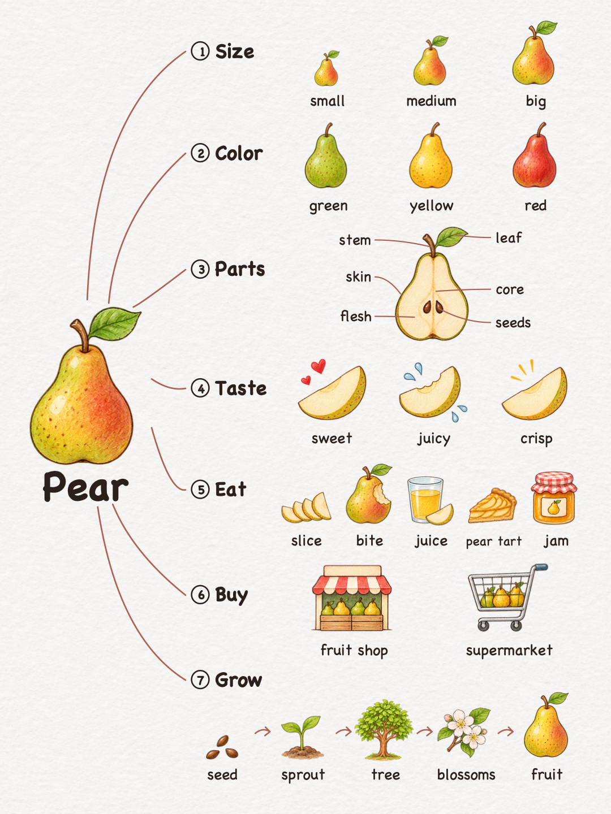
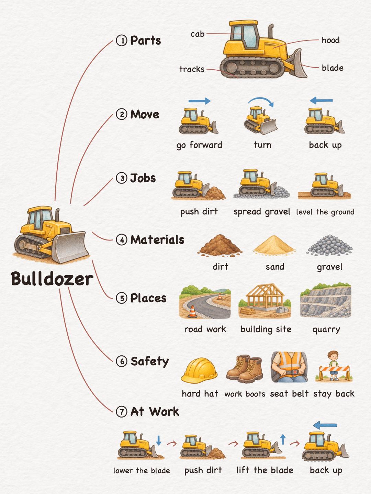
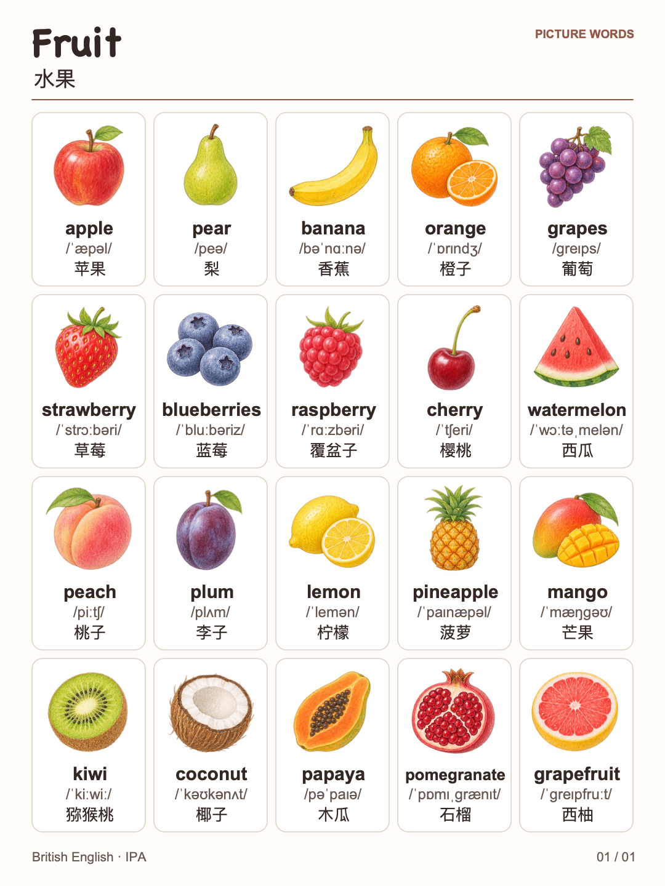
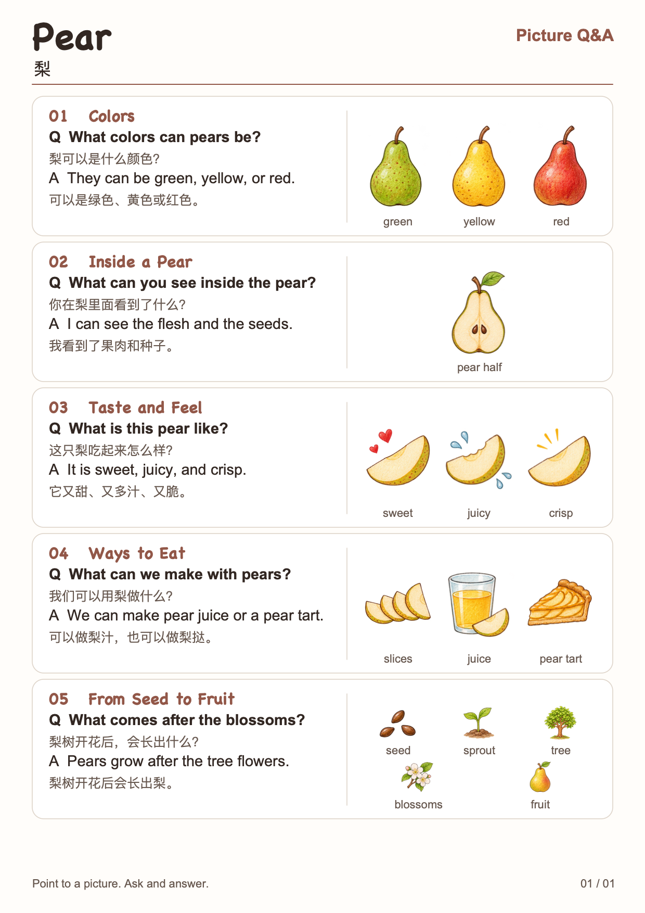
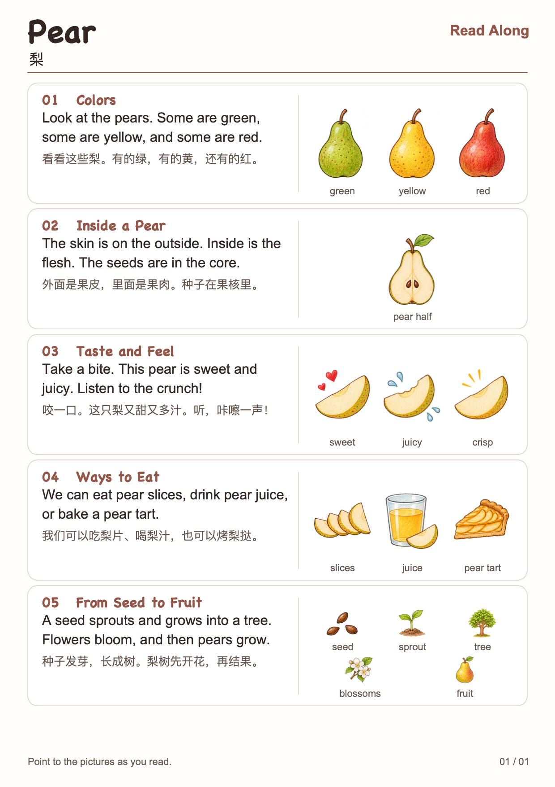
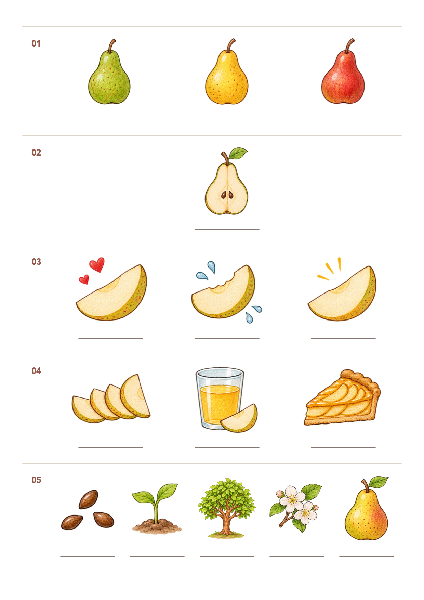
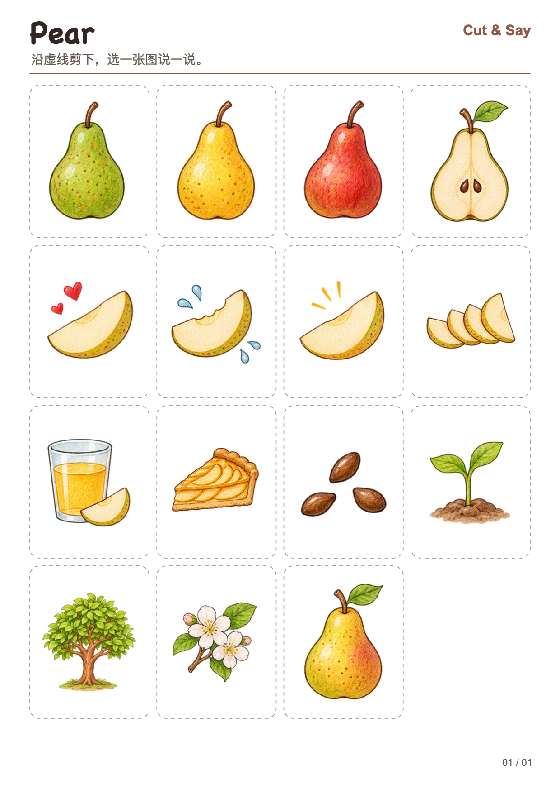

# gogoga-words

把一个主题拆开，用图讲清楚，用英语说出来。

给出一个主题和孩子的英语水平，就能做出主题导图、图文词卡、亲子讲读页或打印练习。

A collection of [Agent Skills](https://agentskills.io/specification) for illustrated English learning materials for children.

| 想让孩子练什么 | 选哪个技能 |
| --- | --- |
| 看懂一个事物的部位、特征和变化 | [主题思维导图](#主题思维导图) |
| 看图认一组词，比如水果、衣服或动物 | [基础词汇图文卡](#基础词汇图文卡) |
| 和大人一起看图问答，或跟读短句 | [亲子讲读页](#亲子讲读页) |
| 自己看图复述，或动手剪贴排序 | [打印互动练习](#打印互动练习) |

## 安装

在目标项目的根目录运行，按提示选择 Codex、Claude Code、Cursor 或其他客户端。需要 Node.js 22.20 或更新版本。 [Skills CLI 安装说明](https://github.com/vercel-labs/skills/blob/main/docs/commands.md#skills-add)

```sh
npx skills add JackWeiGogoga/gogoga-words --skill gogoga-words-mindmap
```

把 `--skill` 后的名字换成下方章节里的技能名，或省略它并在安装时选择。用 `--agent claude-code` 可以指定客户端，`-g` 可以安装到用户目录以供多个项目使用。如果已有本地源码，把命令里的仓库名换成本地目录路径即可。

也可以把 [skills](skills/) 下所需技能的完整文件夹复制到客户端的技能目录。 [各客户端的技能目录](https://github.com/vercel-labs/skills/blob/main/docs/agents.md)

安装后，把下面的示例指令发给 agent，按需换成自己的主题和孩子的英语水平。在 Codex 中也可以用 `$gogoga-words-mindmap` 这类写法点名调用。可以提供透明插画，或让支持生图的 agent 绘制。点击任意示例图可查看原图。

## 主题思维导图

技能名：[gogoga-words-mindmap](skills/gogoga-words-mindmap)

围绕一个事物展开，把能指认的部位、能比较的特征和能按顺序讲的过程画在同一张图上。比如用梨的切面学部位，用箭头讲生长过程；也可以用推土机的侧视图学部件，再看它怎样工作。

| 梨 · 颜色、部位与生长 | 推土机 · 部件与工作过程 |
| :---: | :---: |
| <a href="examples/pear/pear.png"></a> | <a href="examples/bulldozer/bulldozer.png"></a> |

**用法示例**

```text
用 gogoga-words-mindmap 给英语初学的 6 岁孩子做一张梨的导图。
标出果皮、果肉和种子，用箭头画出从种子发芽到结果的过程。
```

示例清单：[梨](examples/pear/pear.json) · [推土机](examples/bulldozer/bulldozer.json)

## 基础词汇图文卡

技能名：[gogoga-words-cards](skills/gogoga-words-cards)

把同一类词排成网格，每格放一幅插画、一个英文词、音标和中文释义。适合做水果、衣服、动物等主题的图画词典。下面这张水果词卡收录了 20 个词，统一标注英式音标。

<a href="examples/fruit/fruit.png"></a>

**用法示例**

```text
用 gogoga-words-cards 做一张水果词卡。选 20 种水果，排成 5 列 4 行。
每格放一幅图，下方写英文、英式音标和中文。
```

示例清单：[水果图文卡](examples/fruit/fruit.json)

## 亲子讲读页

技能名：[gogoga-words-read-along](skills/gogoga-words-read-along)

把主题插画和单词编成可以开口说的短句。**看图问答**为每组图配一个问题和示范回答；**连续领读**把同一组词串成一小段英文。两种都附中文，方便家长带读。

| 梨篇 · 看图问答 | 梨篇 · 连续领读 |
| :---: | :---: |
| <a href="examples/pear/pear-qa.png"></a> | <a href="examples/pear/pear-read.png"></a> |

**用法示例**

```text
用 gogoga-words-read-along 根据这张梨的导图，做一页双语看图问答。
每组图配一个孩子能指着图回答的问题，再给一句简短的英文示范回答。
```

把指令中的「看图问答」换成「连续领读」，就能得到右图的版式。示例清单：[梨篇讲读](examples/pear/lesson.json)。

## 打印互动练习

技能名：[gogoga-words-practice](skills/gogoga-words-practice)

把学过的插画变成 A4 练习。**无字复述页**保留分组图片、组号和空线，让孩子自己说或写。**贴纸页**给每张图加虚线裁切框，可以剪下来做配对、排序或复述。

| 梨篇 · 无字复述 | 梨篇 · 剪贴排序 |
| :---: | :---: |
| <a href="examples/pear/pear-blank.png"></a> | <a href="examples/pear/pear-stickers.png"></a> |

**用法示例**

```text
用 gogoga-words-practice 复用梨篇的插画，做一页无字复述和一页可剪贴纸。
复述页沿用原来的分组，贴纸页让孩子把发芽、开花、结果的图排成正确顺序。
```

练习页和讲读页共用[梨篇清单](examples/pear/lesson.json)，通过 `assets_from` 复用导图插画。

## 复现示例

用 [uv](https://docs.astral.sh/uv/) 从仓库根目录渲染。首次运行会准备 Python 和 Pillow，之后可用缓存离线渲染。生成的 SVG 内嵌插画，文字可编辑。以下命令使用 macOS 自带的 `sips` 导出 PNG。只需 SVG 时，省略 `--png` 及其输出路径即可。

<details>
<summary>展开渲染命令</summary>

```sh
mkdir -p out
uv run --script skills/gogoga-words-mindmap/scripts/render.py \
  examples/pear/pear.json out/pear.svg --png out/pear.png
uv run --script skills/gogoga-words-mindmap/scripts/render.py \
  examples/bulldozer/bulldozer.json out/bulldozer.svg --png out/bulldozer.png
uv run --script skills/gogoga-words-cards/scripts/render.py \
  examples/fruit/fruit.json out/fruit.svg --png out/fruit.png
uv run --script skills/gogoga-words-read-along/scripts/render.py \
  examples/pear/lesson.json out/pear-qa.svg --mode qa --png out/pear-qa.png
uv run --script skills/gogoga-words-read-along/scripts/render.py \
  examples/pear/lesson.json out/pear-read.svg --mode read --png out/pear-read.png
uv run --script skills/gogoga-words-practice/scripts/render.py \
  examples/pear/lesson.json out/pear-blank.svg --mode blank --png out/pear-blank.png
uv run --script skills/gogoga-words-practice/scripts/render.py \
  examples/pear/lesson.json out/pear-stickers.svg --mode stickers --png out/pear-stickers.png
```

</details>

导图和词卡为 1080 × 1440，讲读和练习为 A4 纵向比例。打印时选择「适合页面」。复现预览字体时可用 macOS 的 Chalkboard 系列。

## 项目结构

```text
skills/
├── gogoga-words-mindmap/
├── gogoga-words-cards/
├── gogoga-words-read-along/
└── gogoga-words-practice/
examples/
├── bulldozer/
├── fruit/
└── pear/
tools/
├── worksheet.py
└── sync_worksheet_support.py
```

每个技能目录包含独立的 `SKILL.md`、清单说明和渲染脚本。修改共用的 [worksheet.py](tools/worksheet.py) 后，运行 `python3 tools/sync_worksheet_support.py` 更新词卡、讲读和练习技能各自随包安装的副本。修改或添加主题时，可从现有 JSON 清单开始。报告渲染问题时，请附上可复现的清单和预览。 [Issues](https://github.com/JackWeiGogoga/gogoga-words/issues)

## 许可

项目采用 [MIT 许可](LICENSE)，示例插画和纸底由 AI 生成。
