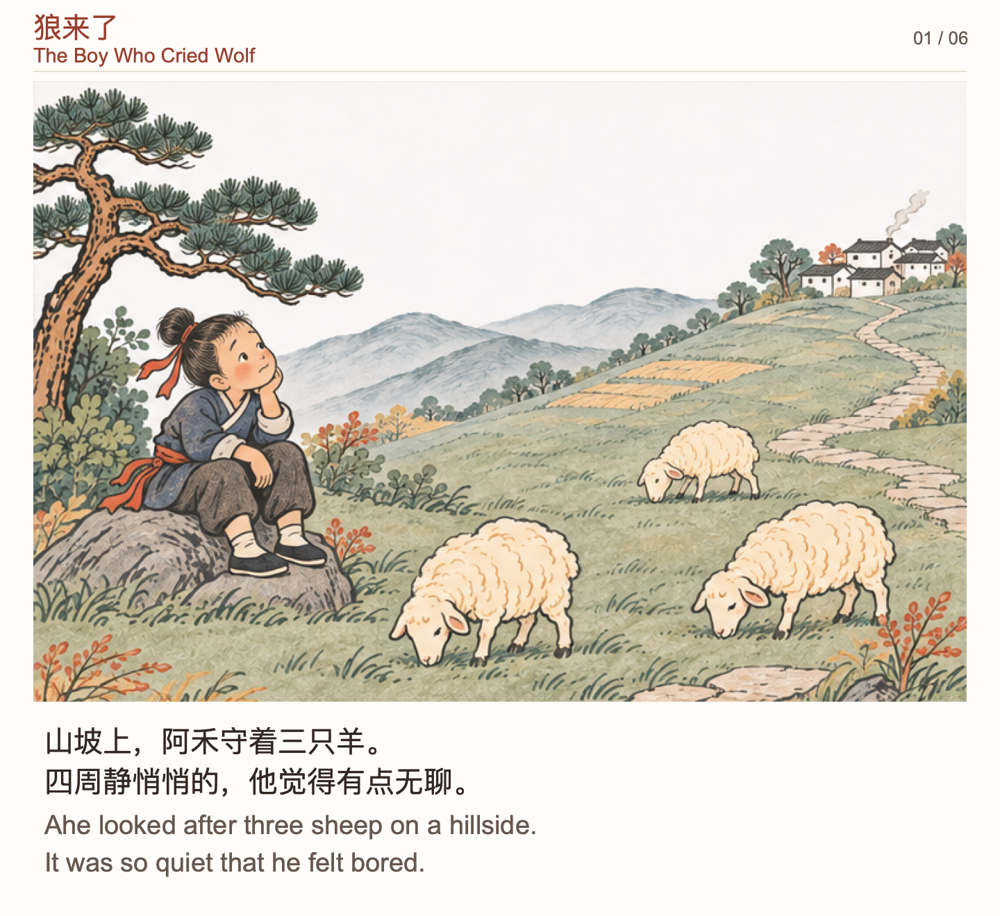
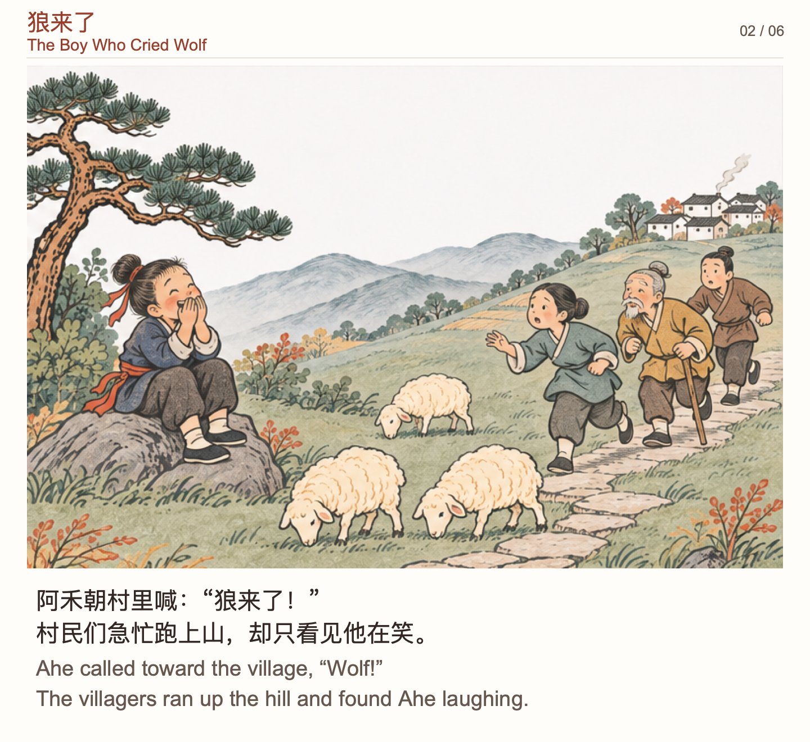
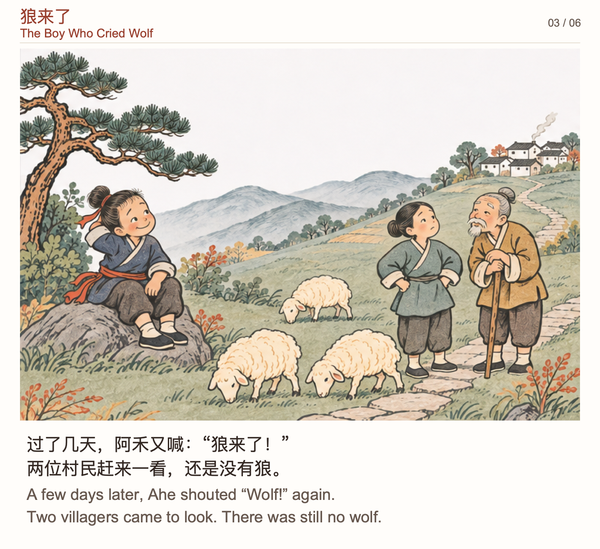
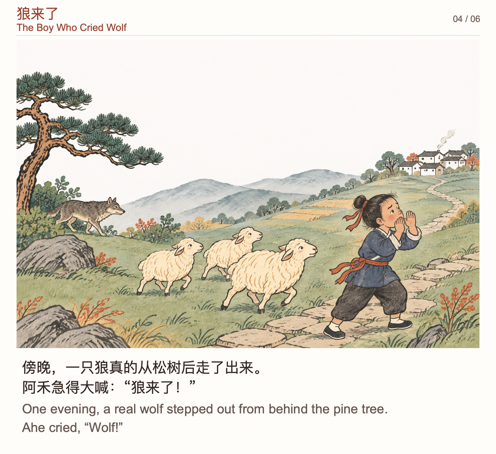
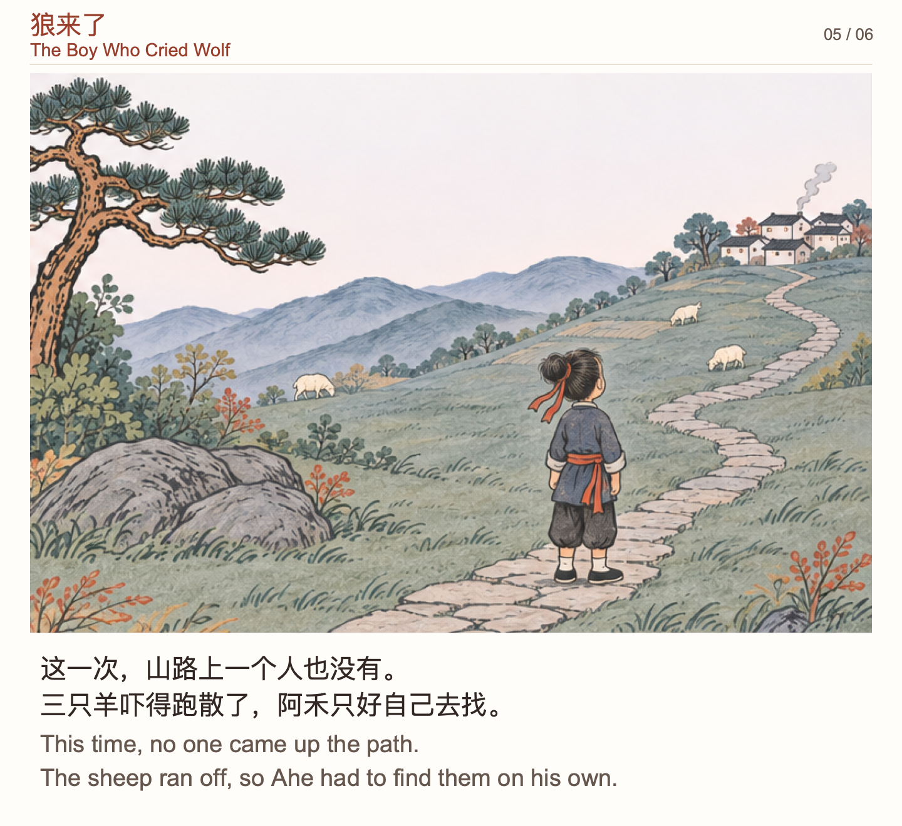
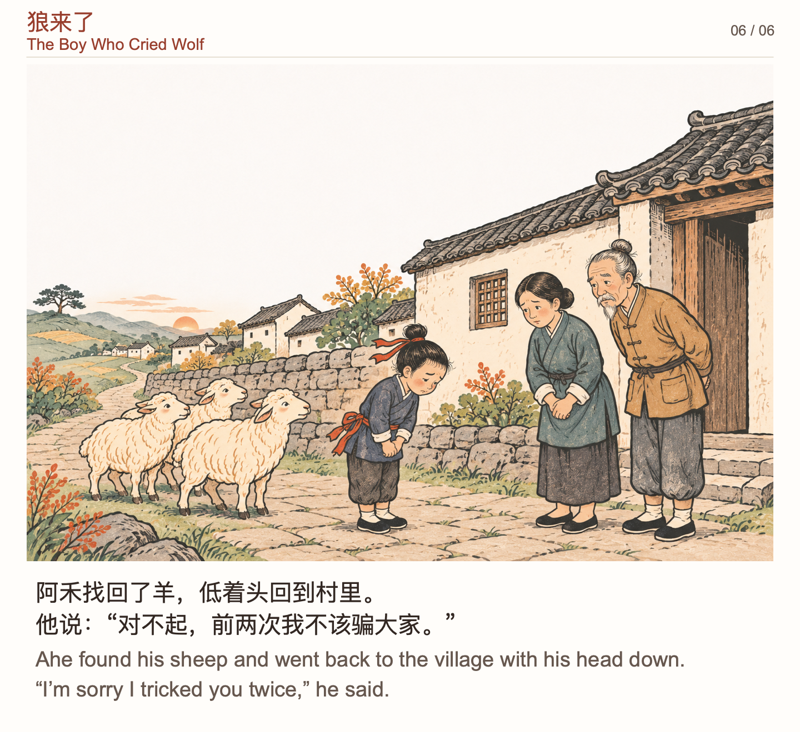

# 狼来了

六页中英双语绘本，使用国风木版淡彩。每页插画下方都有中文故事和对应英文。第三次喊「狼来了」时，翻到下一页才看见空荡荡的山路。结尾让阿禾找回羊群，再回村道歉。

| 01 · 山坡放羊 | 02 · 第一次喊 | 03 · 第二次喊 |
| :---: | :---: | :---: |
| <a href="book-01.png"></a> | <a href="book-02.png"></a> | <a href="book-03.png"></a> |

| 04 · 狼真的来了 | 05 · 空荡荡的山路 | 06 · 回村道歉 |
| :---: | :---: | :---: |
| <a href="book-04.png"></a> | <a href="book-05.png"></a> | <a href="book-06.png"></a> |

## 执行过程

1. **先写六页分镜和中文正文。** 第 2、3 页重复山坡、松树和石路的构图，让孩子比较村民从着急到怀疑的变化。第 5 页只留孩子的背影和空山路，给第三次呼喊留一个停顿。按同一页的动作配简短英文，保留三次重复的 “Wolf!”。
2. **先生成第 4 页作为角色和场景参考。** 阿禾穿靛蓝衣、系朱砂腰带，山坡上有松树、石路和白墙灰瓦的村子。用这张图作为内置 ImageGen 的图像参考，分别生成第 1、2、3、5 页的四格素材和第 6 页的村口近景。见[实际使用的完整提示词](prompts.md)。
3. **按实际像素裁切插画。** 三张原图都放在 [assets](assets/) 里。四格原图是 1536 × 1024，按实际中缝取四个 766 × 510 图块。第 4、6 页用整图。[绘本清单](book.json) 保存了裁切坐标、阅读顺序和每页正文。
4. **用故事技能排版。** `book` 模式输出一图一页，`folk-print` 选用浅底、朱砂标题和细分隔线。中文在上、英文在下，都是 SVG 里的可编辑文字。复现排版直接使用仓库中的插画。
5. **逐页检查。** 对照图和字，确认阿禾的服装、发髻和三只羊能认出来，狼只在第 4 页出现，页码和翻页顺序正确。

## 复现排版

从仓库根目录运行。

```sh
uv run --script skills/gogoga-words-story/scripts/render.py \
  examples/wolf-fable/book.json out/wolf-fable/book.svg \
  --mode book --style folk-print --language bilingual --png out/wolf-fable/book.png
```

输出 `book-01` 到 `book-06`，双语版每页 1440 × 1320。把 `--language` 后的值改成 `zh` 或 `en`，即可生成纯中文或纯英文版。`--png` 使用 macOS 的 `sips`。只需 SVG 时，省略 `--png` 及其输出路径。

共读时可以停在第 5 页问孩子：「这一次，阿禾说了真话，为什么大家却没来？」
